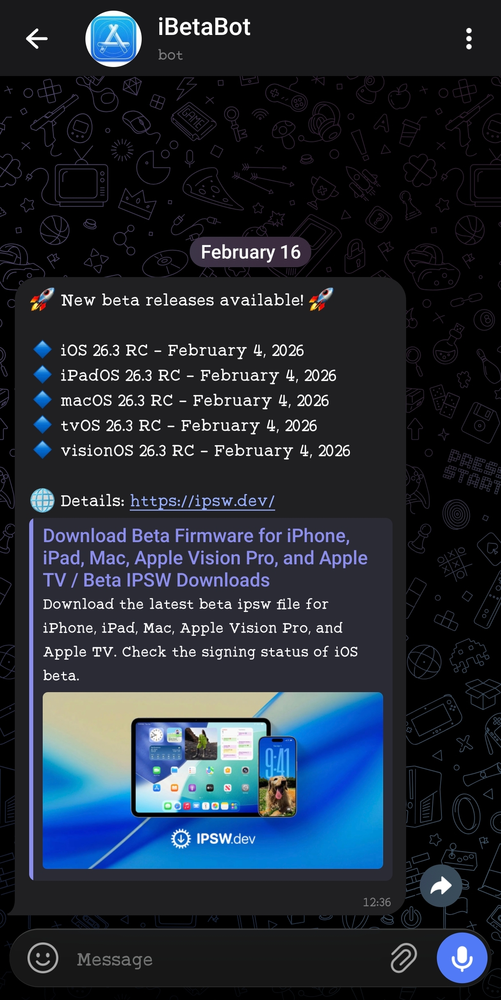

# ⚡ iBetaBot

**Real-time Apple beta & RC firmware watchdog — iOS, iPadOS, macOS, tvOS & visionOS builds pushed straight to Telegram the moment they drop.**

[](https://github.com/pi0trdotsys/iBetaBot/actions/workflows/ibeta_bot.yml)
[](https://github.com/pi0trdotsys/iBetaBot/actions/workflows/tests.yml)
[](https://www.python.org/)
[](LICENSE)
[](https://github.com/pi0trdotsys/iBetaBot/commits/main)

<div align="center">
    
</div>

## Why iBetaBot

No refreshing Apple's release pages, no missed builds, no noise. iBetaBot watches Apple's beta pipeline for you and only speaks up when something actually changes — cron-ready, dependency-light, and running for free on GitHub's own infrastructure.

- 🔭 **Continuous monitoring** — reads Apple's official [developer releases feed](https://developer.apple.com/news/releases/) on a 30-minute schedule for new iOS, iPadOS, macOS, tvOS, visionOS and watchOS beta / RC builds. (It used to scrape IPSW.dev, which now blocks GitHub's servers with a Cloudflare challenge.)
- 🎯 **Signal, not spam** — tracks the *full* set of known releases (not just the page's first entry), so a new build is never missed just because it isn't listed first, and notifications call out only what's actually new instead of resending the whole listing every time; a transient page hiccup gets one retry before it's ever treated as a real break.
- 💬 **Telegram alerts that are a pleasure to read** — a banner and a one-line summary, builds grouped by version with a stage emoji (🧪 beta · 🏁 RC · 📦 release), a platform emoji per line (📱 iOS · 📲 iPadOS · 💻 macOS · 📺 tvOS · 🥽 visionOS · ⌚ watchOS · 🔊 audioOS · 🏠 HomeView), monospaced build numbers and short dates. The same look is used for the heartbeat and for source-down alerts.
- 🧭 **Public Beta context** — alerts that contain a beta carry a historical note on when the Public Beta typically follows a given Developer Beta.
- 🔊 **audioOS & HomeView too** — Apple's feed doesn't carry them, so a small [always-on agent](#always-on-agent-audioos--homeview) reads them from ipsw.dev.
- 💓 **Honest daily heartbeat** — one quiet ping every day confirms the bot is alive even when nothing new has shipped, and it says so loudly if the feed can't be read, instead of claiming everything is fine.
- ☁️ **Zero-maintenance hosting** — runs on GitHub Actions, so it keeps working while your machine is off or asleep.

## How it works

1. Fetches Apple's releases feed and keeps the beta / RC builds of Apple's operating systems (releases older than 30 days are never announced).
2. Compares them against the full set of previously known releases (`ibeta_last_state.txt`).
3. On any genuinely new release, sends a Telegram message naming just what's new and updates the state.
4. Once per UTC day, sends a heartbeat regardless of whether anything changed.

## Running via GitHub Actions (recommended)

The included [`.github/workflows/ibeta_bot.yml`](.github/workflows/ibeta_bot.yml) runs the bot every 30 minutes on GitHub's infrastructure — no server, no always-on laptop required. It commits `ibeta_last_state.txt` and `ibeta_heartbeat_state.txt` back to the repo after each run so state survives between the ephemeral runners.

To enable it, add two repository secrets under **Settings → Secrets and variables → Actions**:

| Secret | Description |
|---|---|
| `TELEGRAM_TOKEN` | Your bot token from [@BotFather](https://t.me/BotFather) |
| `CHAT_ID` | The target chat ID to notify |

You can also trigger a run on demand from the **Actions** tab (`workflow_dispatch`).

## Always-on agent (audioOS & HomeView)

[`ibeta_ipsw.py`](ibeta_ipsw.py) covers the two products Apple's feed lacks, using [ipsw.dev](https://ipsw.dev/). ipsw.dev answers GitHub's datacenter IPs with a Cloudflare challenge, so this part runs on a separate always-on machine (a home server, a small VPS) from cron instead of on Actions. It reuses the bot's formatting, Telegram sending, one-alert-per-outage flag and daily heartbeat, but keeps its own **machine-local, git-ignored** state (`ibeta_ipsw_*.txt`), so it never collides with what the workflow commits. The two trackers cover disjoint product lists, so nothing is announced twice. Its heartbeat is labelled *ipsw.dev agent* so you can tell the two daily pings apart.

> **Whether it works depends on the machine's IP.** A home or small-VPS address usually passes; a big cloud provider's range may get the same Cloudflare challenge as GitHub. If so the agent sends one "source down" alert with the HTTP status (e.g. `HTTP 403 (title='Just a moment...')`) and the daily heartbeat says *Failing* until it can read the page again.

On the server (Linux, Python 3.12+):

```bash
git clone https://github.com/pi0trdotsys/iBetaBot.git && cd iBetaBot
python3 -m venv .venv && .venv/bin/pip install -r requirements.txt
cp .env.example .env && chmod 600 .env     # then fill in TELEGRAM_TOKEN and CHAT_ID (same as the repo secrets)

.venv/bin/python ibeta_ipsw.py             # try it once by hand
crontab -e
```

and add (every 30 minutes, appending to a log):

```cron
*/30 * * * * cd /home/you/iBetaBot && .venv/bin/python ibeta_ipsw.py >> /home/you/iBetaBot/ipsw.log 2>&1
```

`.env` is picked up from the repository directory, so the `cd` matters. A `systemd` timer works just as well if you prefer one. The first run announces whatever audioOS / HomeView builds are younger than 30 days. Network hiccups are logged and skipped without an alert; keep an eye on `ipsw.log` (and rotate it) if the daily heartbeat ever stops arriving.

## Running locally

```bash
git clone https://github.com/pi0trdotsys/iBetaBot.git
cd iBetaBot
pip install -r requirements.txt

# create a .env file with:
# TELEGRAM_TOKEN=your-bot-token
# CHAT_ID=your-chat-id

python ibeta_bot.py
```

Pair it with your own cron/systemd schedule if you'd rather self-host than use GitHub Actions.

## Testing

```bash
pip install -r requirements-dev.txt
pytest -v
```

The [`tests/`](tests/) suite covers both trackers: state persistence, the retry/source-failure handling, heartbeat cadence, message formatting, and — as a standing regression test — the exact duplicate-announcement bug that once shipped in production. A separate [`.github/workflows/tests.yml`](.github/workflows/tests.yml) runs it on every push and pull request, independent of the bot's own scheduled workflow.

## License

[MIT](LICENSE) © Piotr Rosiński
